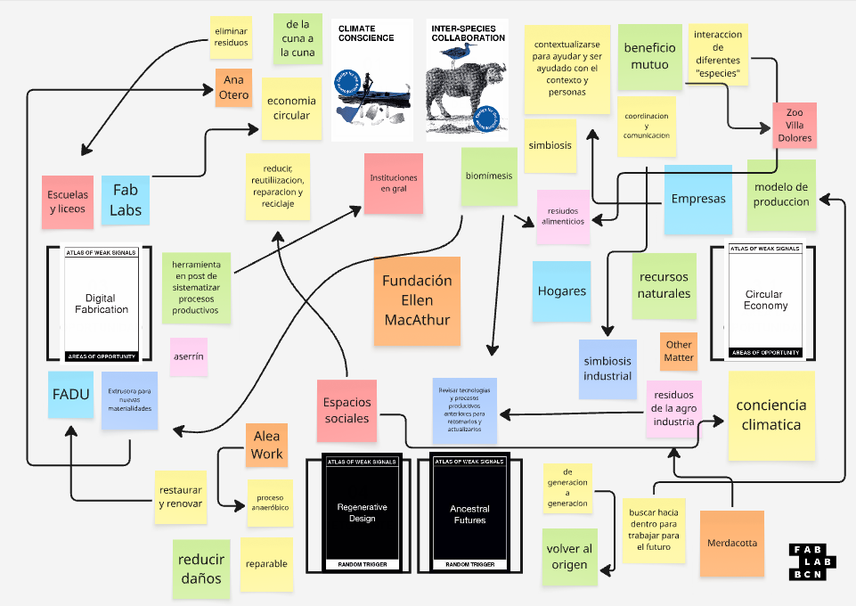
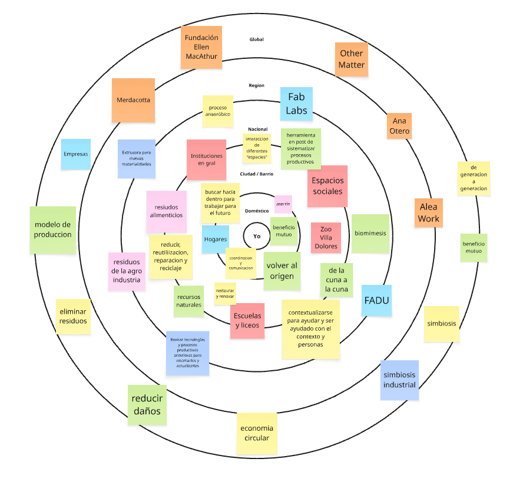
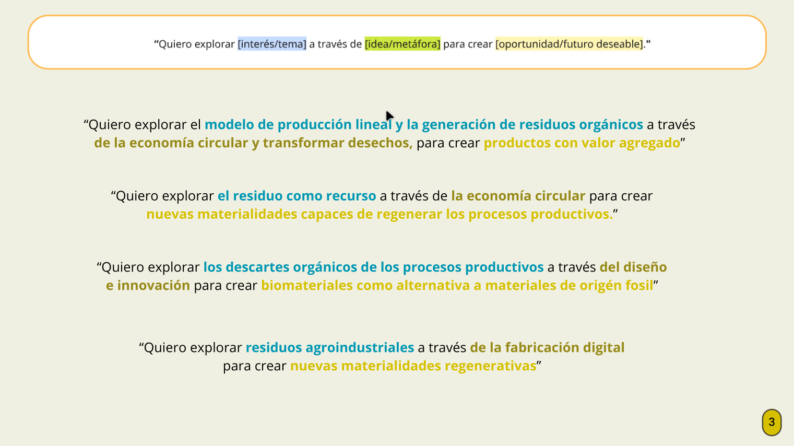

# Módulos de Diseño - Proyecto final 🎨

En relación con mi proyecto final, siempre tuve claro que mi intención es darle continuidad a la investigación desarrollada en mi tesis, tomándola como antecedente y punto de partida para profundizar en los temas abordados, ampliar las líneas de investigación existentes o explorar nuevas áreas que aún no han sido investigadas.

**Mapa de Weak Signals**

{: width="800px"}
El mapa reúne diferentes conceptos, actores y oportunidades vinculados con la economía circular, la sostenibilidad y los modelos de producción regenerativos. A través de las conexiones entre empresas, hogares, instituciones, espacios sociales y entornos naturales, se exploran alternativas para reducir la generación de residuos, reutilizar recursos y promover relaciones de beneficio mutuo entre distintas especies.

También aparecen la biomímesis, la simbiosis industrial, la fabricación digital y el desarrollo de nuevas materialidades como herramientas para repensar los procesos productivos. En este contexto, los residuos orgánicos y agroindustriales dejan de entenderse como desechos y comienzan a visualizarse como recursos con potencial para generar nuevas oportunidades, recuperar materiales y avanzar hacia formas de producción más circulares y regenerativas.

**Dona**

{: width="800px"}

A partir del mapa de  *Weak Signals* , realicé un segundo ejercicio de mapeo para identificar los actores que podrían vincularse con mi investigación. La representación en forma de dona organiza estos actores según escalas de proximidad, desde mi entorno más cercano hasta los ámbitos nacional, regional y global.

El ejercicio permitió reconocer posibles vínculos entre hogares, empresas, instituciones, espacios sociales y organizaciones, así como oportunidades de colaboración e intercambio. También pone en evidencia cómo conceptos como la economía circular, la simbiosis y la biomímesis pueden contribuir a pensar nuevas formas de aprovechar los recursos disponibles.

Este mapeo amplió mi perspectiva sobre el proyecto, permitiéndome entender la revalorización de residuos orgánicos no solo como una exploración material, sino también como una oportunidad para generar conexiones a nivel social y comunitario. 

**Definición del proyecto personal**

{: width="800px"}

Como cierre de esta etapa de exploración, la ultima parte del ejercicio me permitió conectar los conceptos, las señales y las oportunidades identificadas anteriormente para comenzar a definir mi proyecto personal.

La consigna consistió en formular una frase (hice varias) a partir de tres componentes: el problema o interés que quiero abordar, las inspiraciones que me llevaron a repensarlo y la propuesta de acción o futuro que me gustaría construir.

A través de distintas formulaciones, fui delimitando mi interés en la revalorización de residuos orgánicos y agroindustriales, la economía circular y el desarrollo de nuevas materialidades. Este ejercicio me permitió reconocer un posible camino de investigación: explorar los residuos como recursos para desarrollar biomateriales y nuevas aplicaciones que contribuyan a transformar los procesos productivos.

📥 [Para ver entrega MD01 haceme clic](Tarea_final_MD01.pdf)