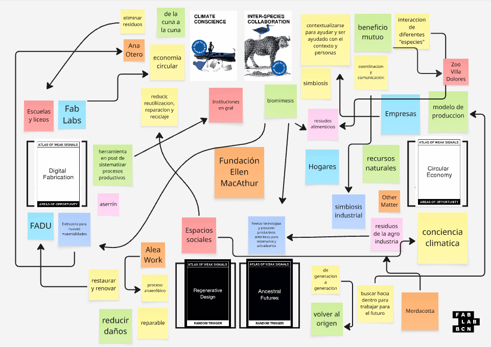
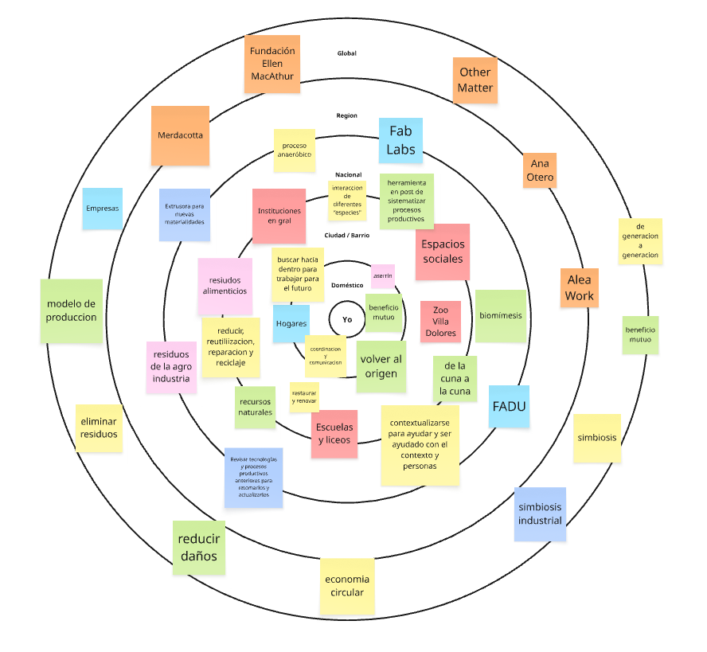

# Módulos de Diseño - Proyecto final 🎨

En relación con mi proyecto final, siempre tuve claro que mi intención es darle continuidad a la investigación desarrollada en mi tesis, tomándola como antecedente y punto de partida para profundizar en los temas abordados, ampliar las líneas de investigación existentes o explorar nuevas áreas que aún no han sido investigadas.

* Mapa de Weak Signals*

{: width="800px"}
El mapa reúne diferentes conceptos, actores y oportunidades vinculados con la economía circular, la sostenibilidad y los modelos de producción regenerativos. A través de las conexiones entre empresas, hogares, instituciones, espacios sociales y entornos naturales, se exploran alternativas para reducir la generación de residuos, reutilizar recursos y promover relaciones de beneficio mutuo entre distintas especies. 

También aparecen la biomímesis, la simbiosis industrial, la fabricación digital y el desarrollo de nuevas materialidades como herramientas para repensar los procesos productivos. En este contexto, los residuos orgánicos y agroindustriales dejan de entenderse como desechos y comienzan a visualizarse como recursos con potencial para generar nuevas oportunidades, recuperar materiales y avanzar hacia formas de producción más circulares y regenerativas.

*Dona*

{: width="800px"}