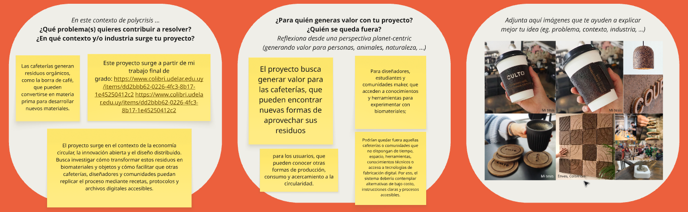
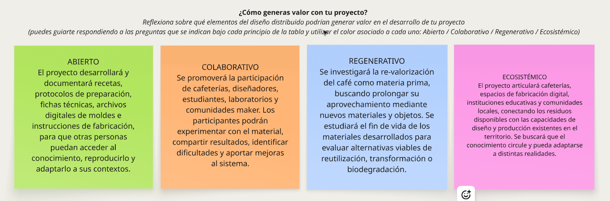

---
hide:
    - toc
---
# **Innovación Abierta y Distribuida 💡**

En este ejercicio trabajé sobre los principios de Innovación Abierta y Diseño Distribuido, buscando explorar cómo incorporarlos a mi proyecto de biomateriales a partir de residuos de café y ampliar su impacto más allá del desarrollo material, considerando nuevas formas de colaboración, intercambio de conocimientos y generación de valor.

{: width="800px"}

Este ejercicio me permitió profundizar en el contexto de mi proyecto, identificando el problema que busco abordar y a quiénes podría generar valor. La propuesta parte de los residuos orgánicos que generan las cafeterías, particularmente la borra de café, como materia prima para desarrollar nuevos biomateriales y productos. A partir de mi tesis de grado, busco explorar nuevas formas de aprovechar estos residuos, generando oportunidades para las cafeterías, diseñadores, estudiantes y comunidades maker. También consideré quiénes podrían quedar fuera de la propuesta, reconociendo la importancia de desarrollar alternativas accesibles en cuanto a costos, herramientas y conocimientos.

{: width="800px"}

Posteriormente, trabajé sobre cuatro dimensiones del Diseño Distribuido: abierta, colaborativa, regenerativa y ecosistémica. Desde lo abierto, propongo compartir recetas, protocolos, fichas técnicas y archivos digitales que permitan reproducir y adaptar los procesos. Desde lo colaborativo, promover la participación de cafeterías, diseñadores, estudiantes y comunidades maker. Desde lo regenerativo, investigar nuevas formas de revalorizar el café como materia prima y prolongar su aprovechamiento mediante materiales y productos. Finalmente, desde lo ecosistémico, conectar cafeterías, espacios de fabricación digital, instituciones educativas y comunidades locales para favorecer el intercambio de conocimientos y capacidades.

**Reflexión final**

Como reflexión final, este proceso me permitió ampliar la mirada sobre mi proyecto, entendiendo que su desarrollo no debería limitarse a la transformación de residuos en nuevos materiales y productos, sino también contemplar cómo compartir el conocimiento, generar redes de colaboración y construir modelos de producción más circulares. Uno de los principales desafíos que identifico es encontrar un equilibrio entre la apertura y accesibilidad de la propuesta y su sostenibilidad económica, de manera que sea posible generar valor y remunerar el trabajo de diseño e investigación sin limitar el acceso al conocimiento.

📥 [Para ver entrega MI01 haceme clic](Tarea_final_MI01.pdf)