# FP01 - Fabricación presencial en Lab 👩🏽‍🔬

El 30 de octubre visitamos el laboratorio de UTEC, ubicado en Treinta y Tres 750, en la ciudad de Minas, departamento de Lavalleja. Durante la jornada trabajamos con la cortadora láser de CO₂, utilizando el software RDWorks, y fabricamos una luminaria. En mi caso, utilicé MDF de 3 mm de espesor.

La visita me permitió conocer sus instalaciones, los espacios de trabajo y los recursos disponibles, así como acercarme a las posibilidades que ofrece el laboratorio para la experimentación, el desarrollo de proyectos y la fabricación digital.

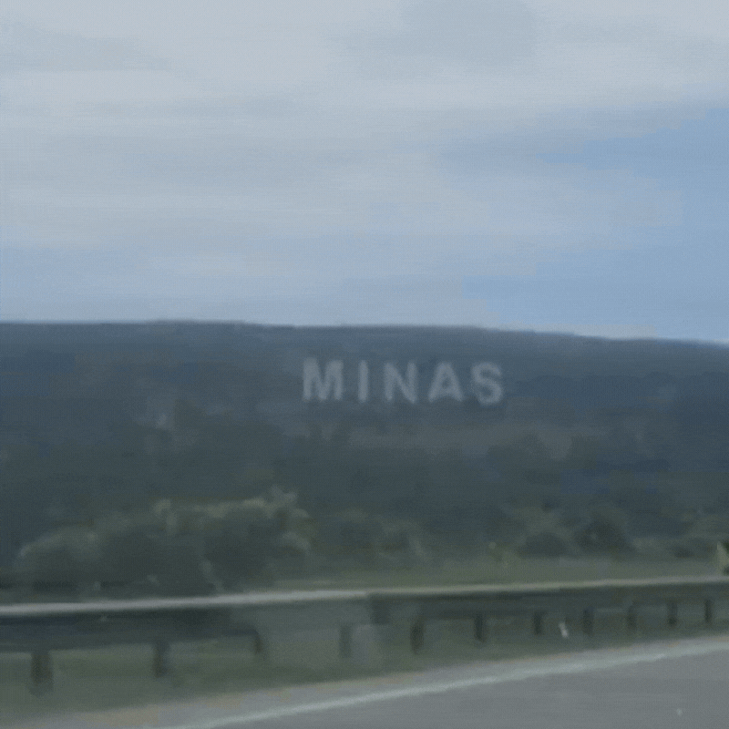{: width="300px"} 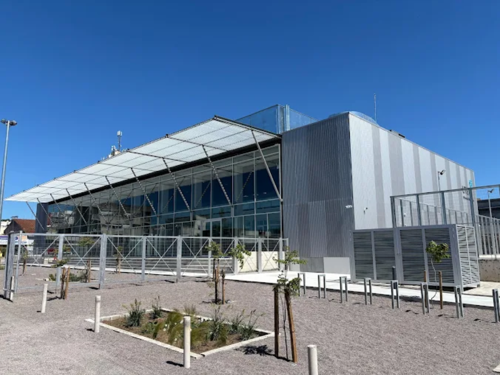{: width="400px"}

La experiencia en el laboratorio fue muy interesante, principalmente por el intercambio y el aprendizaje compartido que no siempre tenemos en las clases, al desarrollarse en modalidad online. Si bien ya estaba familiarizada con el corte láser, aproveché la instancia para prestar atención a aquellos aspectos que aún no conocía, especialmente el manejo y la puesta en marcha de la máquina. Aunque sé que las configuraciones pueden variar según el modelo y el material utilizado, me interesaba comprender el procedimiento básico para hacerla funcionar.

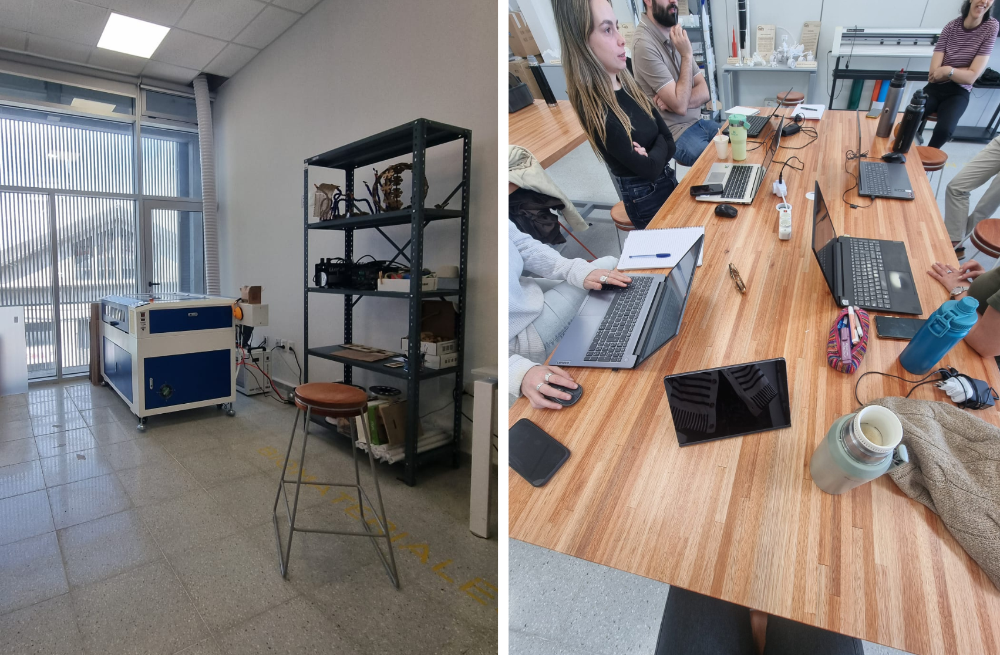{: width="800px"}

Por eso, dejo un pequeño resumen de los pasos que se deben seguir una vez encendida la máquina de cortadora laser:

* **Encendido:** prender la máquina desde el interruptor ubicado en el lateral y accionar la perilla que se encuentra arriba de la pantalla.
* **Distancia del láser:** verificar que la distancia entre el cabezal láser y el material sea de 7 mm.
* **Carga del archivo:** colocar el pendrive y descargar el archivo desde el pendrive a la memoria de la máquina.
* **Verificación del área de trabajo:** antes de comenzar, me pareció especialmente útil conocer la función Frame, que permite visualizar y delimitar sobre el material el área que ocupará el corte o grabado. De esta manera, podemos comprobar que el diseño esté correctamente ubicado y que no exceda los límites del material.
* **Inicio del trabajo:** una vez realizadas estas comprobaciones, se puede comenzar con el corte o grabado.

La interfaz estaba completamente en inglés y cada máquina tiene sus particularidades. El procedimiento puede variar según el modelo, por lo que este resumen corresponde a la experiencia con la máquina utilizada en el laboratorio. Sin embargo, me pareció interesante compartirlo, ya que pude realizar el procedimiento varias veces para ayudar a otros compañeros con sus trabajos. A partir de la práctica y la repetición, fui ganando confianza y comprendiendo mejor cómo operar la máquina.

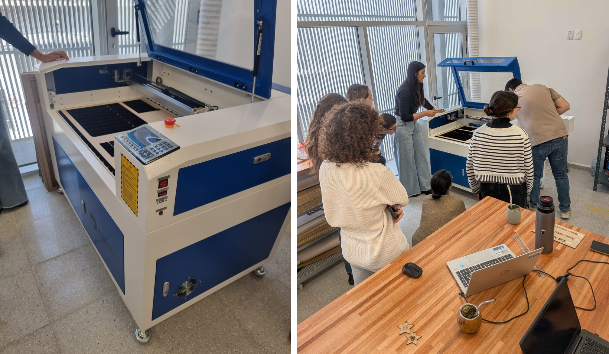{: width="800px"}

**RDWorks**

En relacion a los parámetros que coloque, los cuales copié desde un tutorial de moodle, al llegar al Laboratorio, la cortadora laser tiene sus propios parámetros, por lo tanto tuve que cambiarlos y los deje de este modo:

*A CUT le coloqué:*

- speed: 30
- procesing mode: cut
- min power: 50 / max power: 50

*A RASTER le coloqué:*

- speed: 400
- procesing mode: scan
- min power: 30 / max power: 30
- Intervalo: 0,02

*A SCORE le coloqué:*

- speed: 80
- procesing mode: pen
- min power: 20 / max power: 20

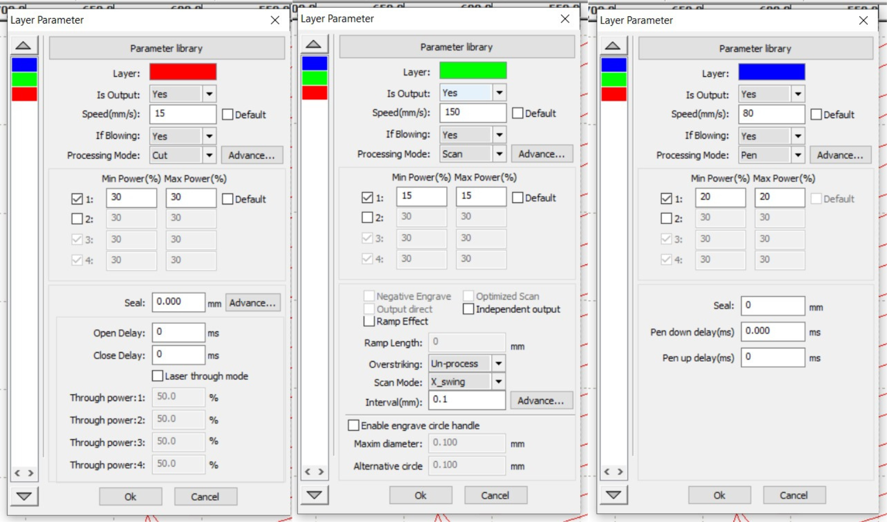{: width="800px"}

En RDWorks habian 4 funciones: cut, scan, pen y dot. No sabía que era dot ni pen, buscando en internet entendi que pen era grabado lineal, por lo tanto le coloque esa acción en configuracion. El resultado: me habia equivocado, no me grabo lineal, si bien paso por alli el laser interpretando el diseño no quedo ninguna modificación en el mdf. Luego indagando mas en internet encontré que:

* PEN es: dibujo/marcado con bolígrafo
* DOT es: punteado

**Proceso**

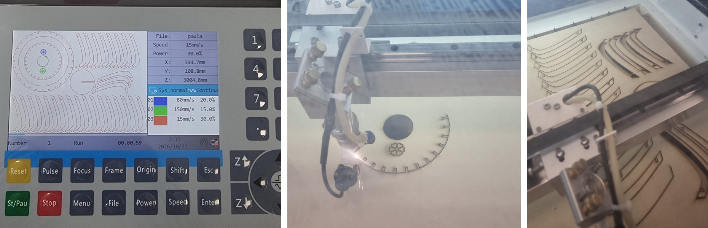{: width="800px"}

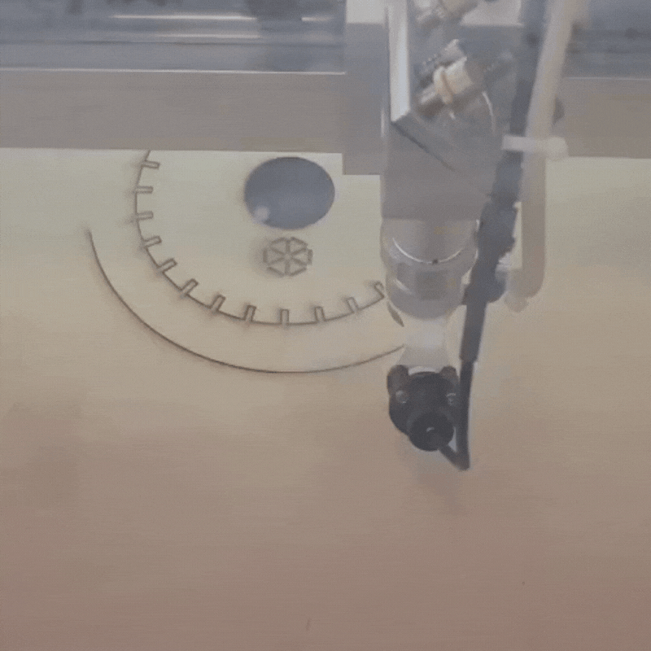{: width="375px"} 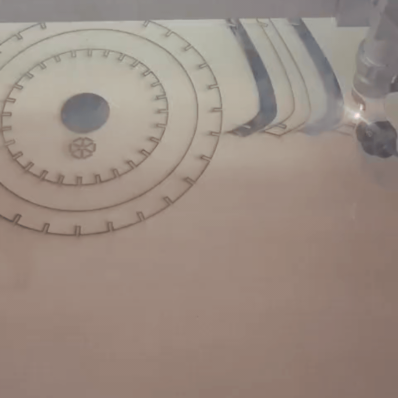{: width="375px"}

**Proceso de armado**

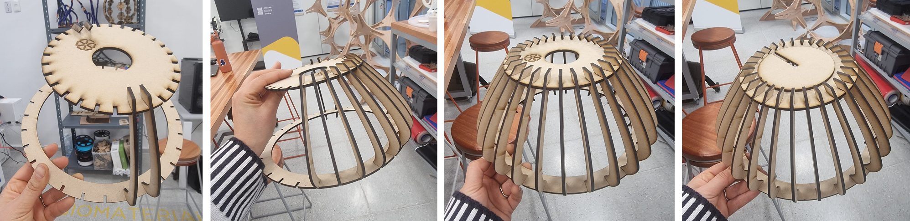{: width="800px"}

**Colocada en la oficina**

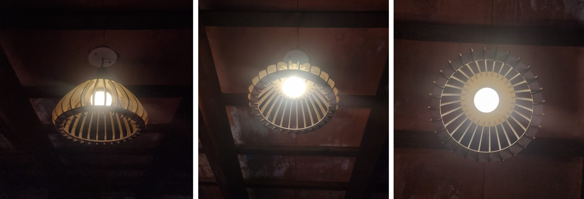{: width="800px"}

**Reflexion final**

Fue una experiencia sumamente enriquecedora. En lo personal, disfruto mucho de los espacios de intercambio, de vincularme con otras personas y aprender de sus experiencias y perspectivas. Me resultó muy interesante conocer cómo piensan y abordan el diseño los demás, descubrir de dónde surgen sus ideas y cómo encuentran distintas maneras de resolver un mismo desafío.

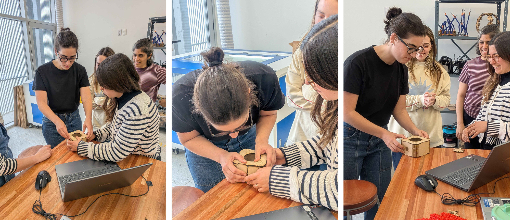{: width="800px"}

Por otro lado, confirmé cuánto disfruto de estar en los laboratorios y trabajar desde la práctica. Los talleres siempre son los espacios donde me siento más cómoda: experimentando y haciendo. Poder materializar en 3D un diseño es de las cosas que más me satisfacen. Ver cómo algo que imaginaste empieza a tomar forma y se convierte en un objeto real es una de las partes del proceso de diseño que más disfruto.

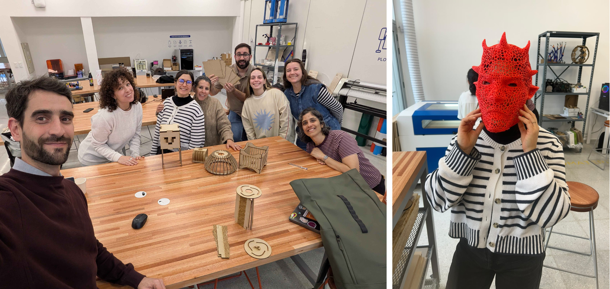{: width="800px"}

