 

# MT02 - Diseño 2D y Modelado 3D ✒️

**Intro :)**

Actualmente, mi computadora de trabajo es una MacBook Pro del año 2010. Antes de comenzar el posgrado, se me rompió la computadora que utilizaba y tuve que restaurar esta para poder continuar con mis estudios y proyectos. Para aprovechar mejor sus recursos y mejorar su rendimiento, decidí instalar Linux Mint.

Esta decisión también forma parte de un cambio en mi forma de trabajar: quiero comenzar a utilizar programas de código abierto y herramientas libres que me permitan diseñar, modelar y desarrollar proyectos sin depender de licencias pagas. Me interesa explorar alternativas accesibles que pueda seguir utilizando a largo plazo, durante el posgrado, priorizando herramientas que respeten la libertad de uso. Sin embargo, me vi embarcada a conocer nuevos programas, ya con conocimientos en varios programas en el trayacto de mi trabajo pensé que no iba a ser tan dificil y podria beneficiarme para el dia de mañana sentarme delante de cualquier programa y saber utilizarlo.

Antes el programa de vectores que usaba era Ilustrator, que lo cambiaria por Inskape y en 3d el que mas usé fue fusion 360. En el posgrado nos dieron una licencia por lo tanto, busque la forma de descargarmelo aunque no iba con esta nueva modalidad, porque tengo gran facilidad al usarlo y se todos los beneficios que tiene con el uso de la fabricacion digital.

Me descargué un programa llamado Bottles permite ejecutar aplicaciones de Windows.

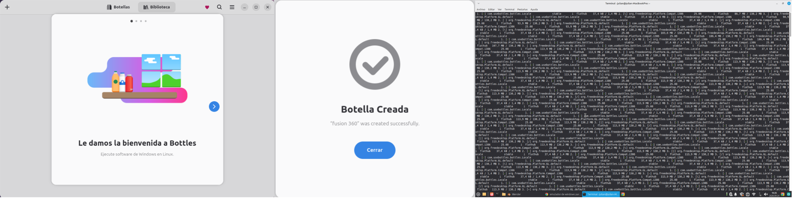{: width="800px"}
Pero no tuve suerte ya que despues de varias horas intentando instalarlo y consultando a la IA, llegué a la conclusion que no soportaba mi tarjeta de video el programa. Por lo tanto, me descargué un programa sin licencia, que en este caso es FreeCad.

**Diseño 2d**

En inskape vectoricé el logo que le iba a colocar al modelado 3d:

*Pasos para vectorizar en Inkscape:*

* Importar imágen: Archivo > Importar.
* Menú superior y seleccionar Trayecto > Vectorizar mapa de bits o también se puede hacer clic derecho sobre la imagen y elegir esa opción (como hice yo).
* Seleccionar la opcion de auto trazo.

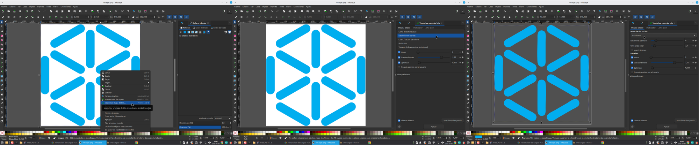{: width="800px"}

**Diseño 3d**

Queria realizar un objeto de escala manual, que tenga que ver con la UTEC. Me decidí realizar un souvenir de la UTEC: un llavero. La parte metálica se agregaria luego. Queria realizar algo simple pero que no sea una pieza sola y que sea articulable para aprender a usar el programa, busqué ideas y concrete la siguiente:

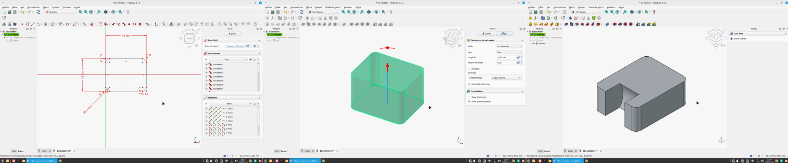{: width="800px"}
*♡ dibujar y extruir ♡*

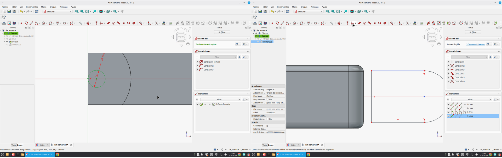{: width="800px"}
*♡ parametrizar y restringír is my obsession ♡*

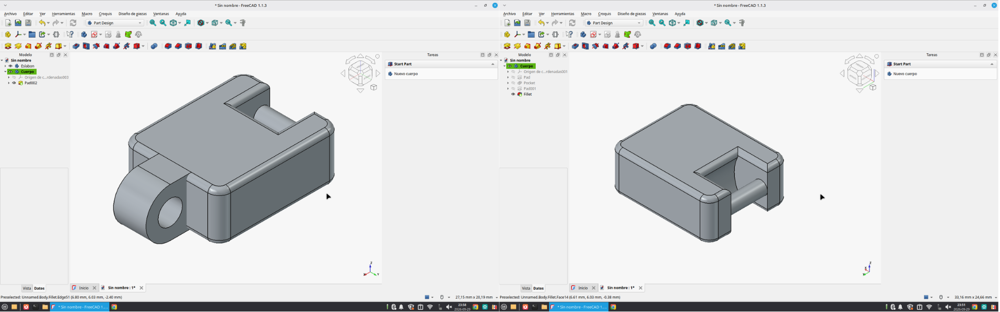{: width="800px"}
*♡ Dos primeras piezas realizadas y fillets realizados ♡*

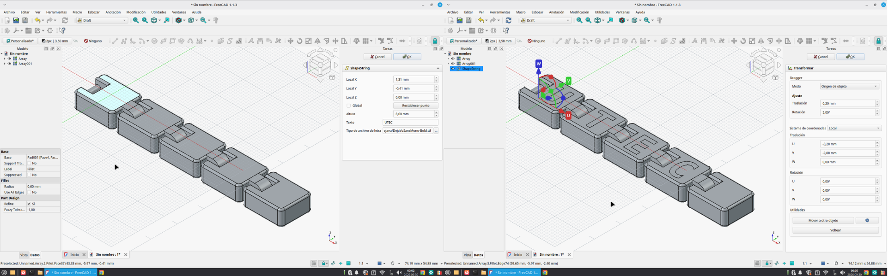{: width="800px"}
*♡ Replico piezas en espacio de trabajo Draft y agrego letras ♡*

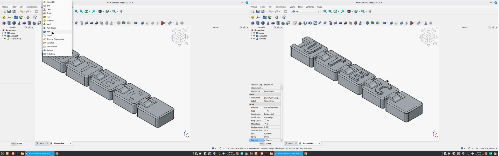{: width="800px"}
*♡ Vuelvo a Part a extruir letras ♡*

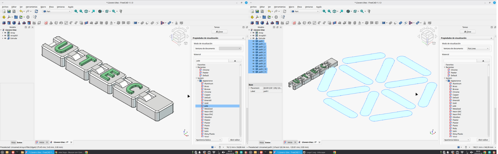{: width="800px"}
*♡ Le coloco apariencia a las letras e importo el logo: lo escalo y extruyo ♡*

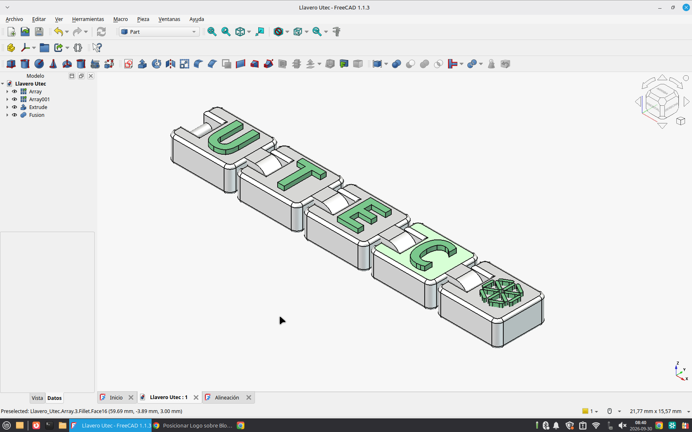{: width="800px"}
*♡ Listo, llavero terminado ♡*

📥 [Para ver lámina final haceme clic](Láminadepresentación_PaulaDiazCalo.pdf)

*Pd: No pude realizar el render directamente en FreeCAD, ya que aún necesitaba instalar y configurar las herramientas adicionales necesarias para utilizar esa función. Por este motivo, la imagen que se presenta en la lámina fue elaborada con ayuda de inteligencia artificial (ChatGPT), con el objetivo de mejorar la presentación visual del diseño y lograr una apariencia más cercana a una imagen de producto final, en lugar de utilizar únicamente capturas de pantalla del programa.*

# MT03 - Corte láser controlado por computadora 📐

Para este ejercicio, la consigna consistía en diseñar una luminaria. Decidí desarrollar una propuesta encastrable que pudiera utilizar en mi propia cocina, ya que necesitaba una, por lo que el diseño se pensó específicamente para ese espacio. Mi intención era crear una pieza de geometría laminar y de fácil ensamblaje. En relación al diseño, hay muchisimas en internet con diferentes encastres, tome de referncias diseños de internet y encastres ya existentes:

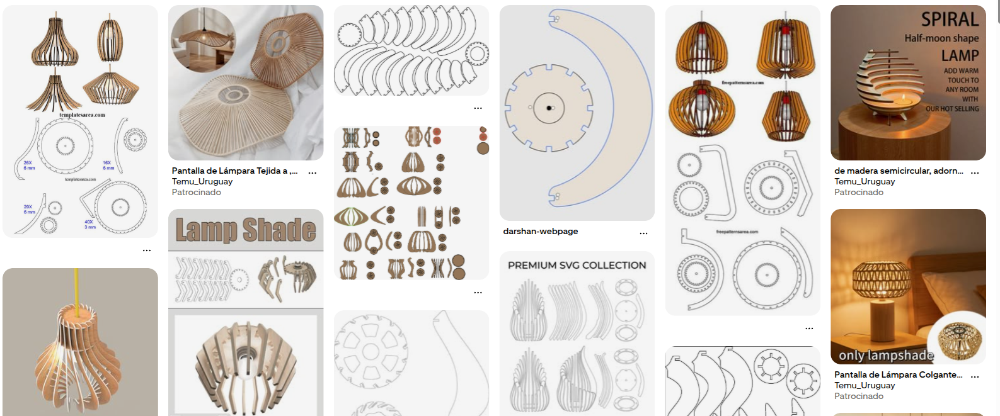{: width="800px"}

En cuanto a la iluminación, busqué que la luz se distribuyera de manera homogénea y que, al mismo tiempo, se filtrara a través de las láminas, proyectando un patrón de luces y sombras sobre el techo. Por otra parte, decidí dejar la parte inferior abierta, sin elementos que obstruyeran la salida de la luz, para favorecer una iluminación directa y funcional sobre la cocina.

Primero modelé en 3d la luminaria [ver captura de imagen de modelado](ImágenesLuminaria.pdf) y luego todas sus partes las coloque en un plano, listo para agregarle en inskape las capas y los logos, para posterior configurarlo en RDWorks.

📥 [Descargar archivo de FreeCAD](Luminaria_Paula_Diaz.FCStd)

**Inskape**

Finalmente, en la pieza de la parte superior incorporé dos versiones del logotipo de UTEC: una lineal y otra raster, con el objetivo de explorar y comparar ambas técnicas de grabado láser.

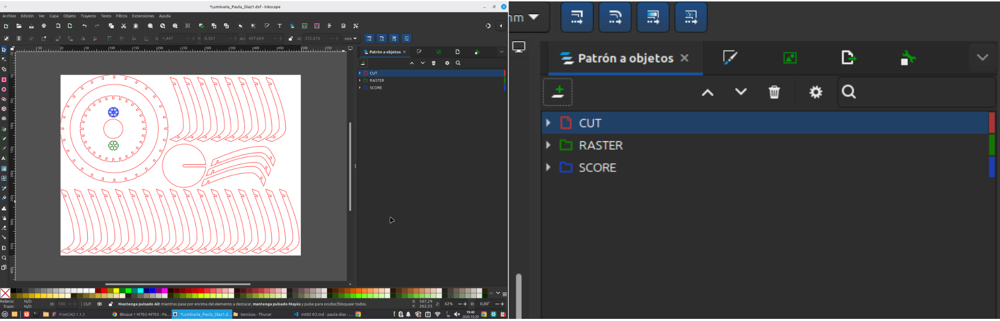{: width="800px"}

Agregue tres capas diferentes, en rojo CUT, en verde RASTER y en azul SCORE. Y de la misma forma quiero configurarlo en el archivo RDWorks.

**RDWorks**

Este programa lo tuve que descargar en otra pc ya que es solo para linux.
La configuración la copié de un video tutorial subido a moodle.

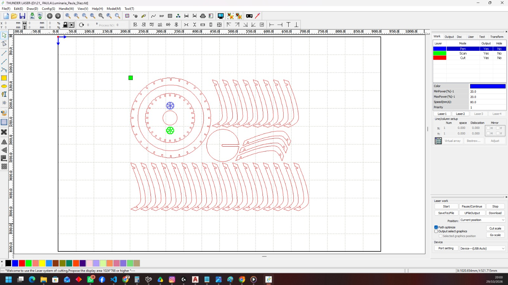{: width="800px"}

*A CUT le coloqué:*

- speed: 30
- procesing mode: cut
- min power: 50 / max power: 50

*A RASTER le coloqué:*

- speed: 400
- procesing mode: scan
- min power: 30 / max power: 30
- Intervalo: 0,02

*A SCORE le coloqué:*

- speed: 80
- procesing mode: pen
- min power: 20 / max power: 20

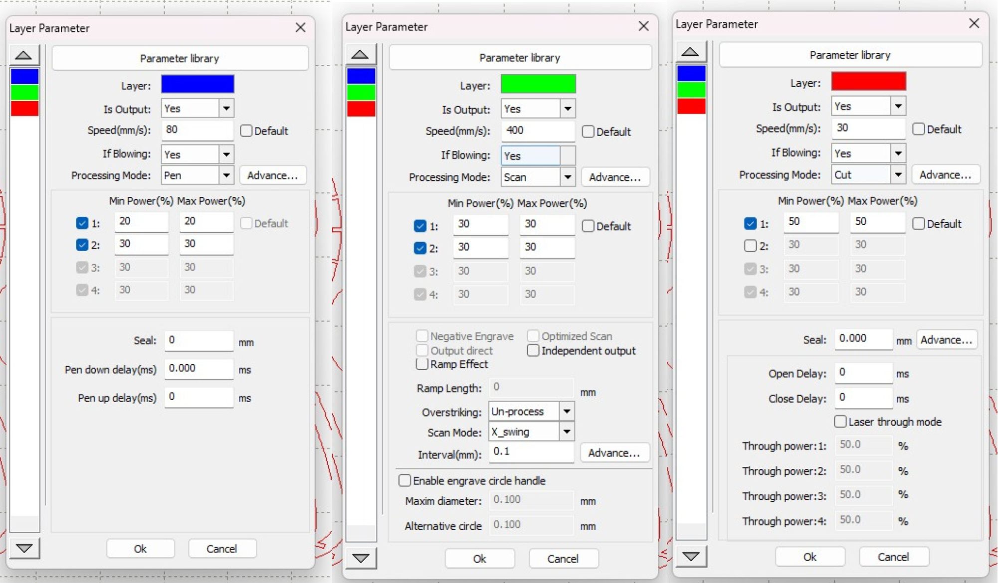{: width="800px"}

**Experiencia en el Laboratorio de Minas**

La experiencia en el laboratorio fue muy interesante, principalmente por el intercambio y el aprendizaje compartido que no siempre tenemos en las clases, al desarrollarse en modalidad online. Si bien ya estaba familiarizada con el corte láser, aproveché la instancia para prestar atención a aquellos aspectos que aún no conocía, especialmente el manejo y la puesta en marcha de la máquina. Aunque sé que las configuraciones pueden variar según el modelo y el material utilizado, me interesaba comprender el procedimiento básico para hacerla funcionar.

Por eso, dejo un pequeño resumen de los pasos que se deben seguir una vez encendida la máquina e insertado el pendrive con el archivo:

* **Encendido:** prender la máquina desde el interruptor ubicado en el lateral y accionar la perilla que se encuentra arriba de la pantalla.
* **Distancia del láser:** verificar que la distancia entre el cabezal láser y el material sea de 7 mm.
* **Carga del archivo:** descargar el archivo desde el pendrive a la memoria de la máquina.
* **Verificación del área de trabajo:** antes de comenzar, me pareció especialmente útil conocer la función Frame, que permite visualizar y delimitar sobre el material el área que ocupará el corte o grabado. De esta manera, podemos comprobar que el diseño esté correctamente ubicado y que no exceda los límites del material.
* **Inicio del trabajo:** una vez realizadas estas comprobaciones, se puede comenzar con el corte o grabado.

La interfaz estaba completamente en inglés y cada máquina tiene sus particularidades. El procedimiento puede variar según el modelo, por lo que este resumen corresponde a la experiencia con la máquina utilizada en el laboratorio. Sin embargo, me pareció interesante compartirlo, ya que pude realizar el procedimiento varias veces para ayudar a otros compañeros con sus trabajos. A partir de la práctica y la repetición, fui ganando confianza y comprendiendo mejor cómo operar la máquina.

En relacion a los parámetros que coloque, los cuales copié desde un tutorial de moodle, al llegar al Laboratorio, la cortadora laser tiene sus propios parámetros, por lo tanto tuve que cambiarlos y los deje de este modo:

*A CUT le coloqué:*

- speed: 30
- procesing mode: cut
- min power: 50 / max power: 50

*A RASTER le coloqué:*

- speed: 400
- procesing mode: scan
- min power: 30 / max power: 30
- Intervalo: 0,02

*A SCORE le coloqué:*

- speed: 80
- procesing mode: pen
- min power: 20 / max power: 20

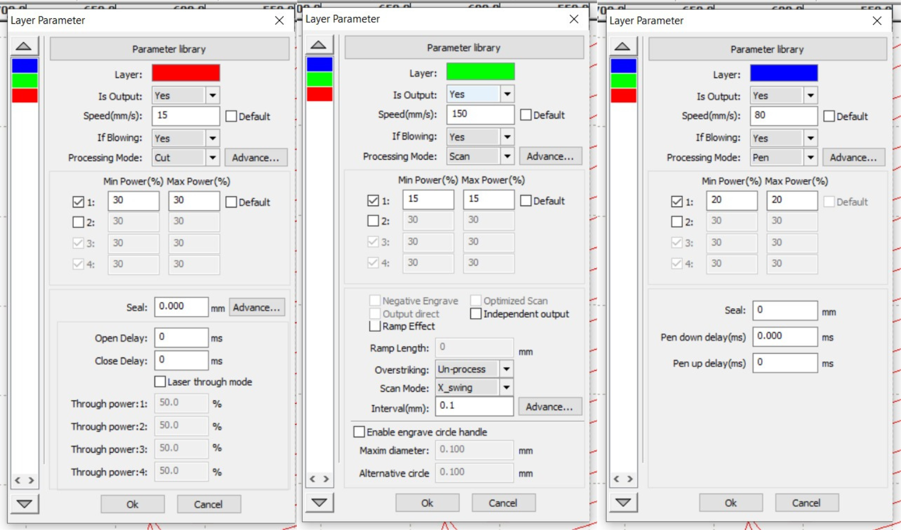{: width="800px"}

En RDWorks habian 4 funciones: cut, scan, pen y dot. No sabía que era dot ni pen, buscando en internet entendi que pen era grabado lineal, por lo tanto le coloque esa acción en configuracion. El resultado: me habia equivocado, no me grabo lineal, si bien paso por alli el laser interpretando el diseño no quedo ninguna modificación en el mdf. Luego indagando mas en internet encontré que:

* PEN es: dibujo/marcado con bolígrafo
* DOT es: punteado

**Proceso**

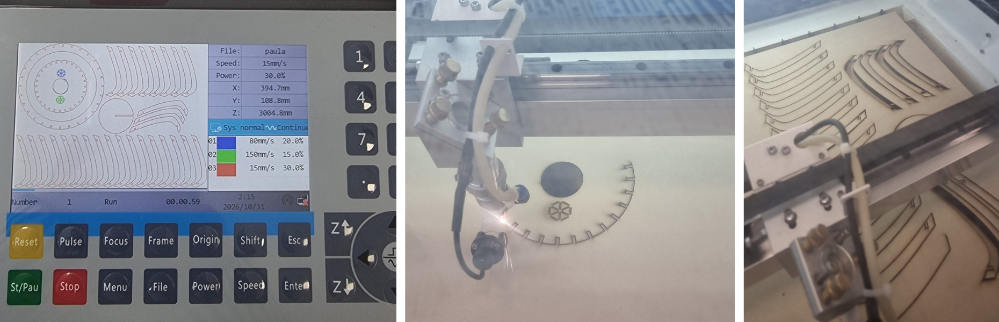{: width="800px"}

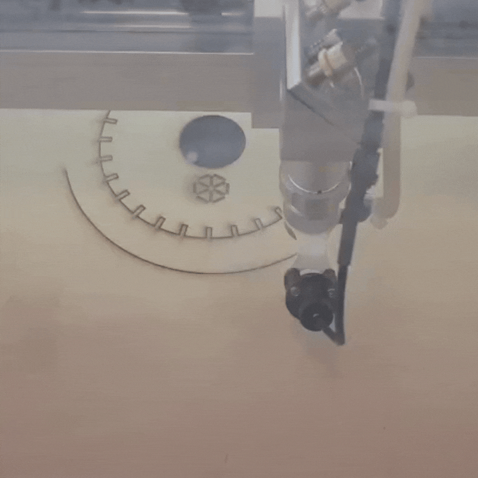{: width="375px"} 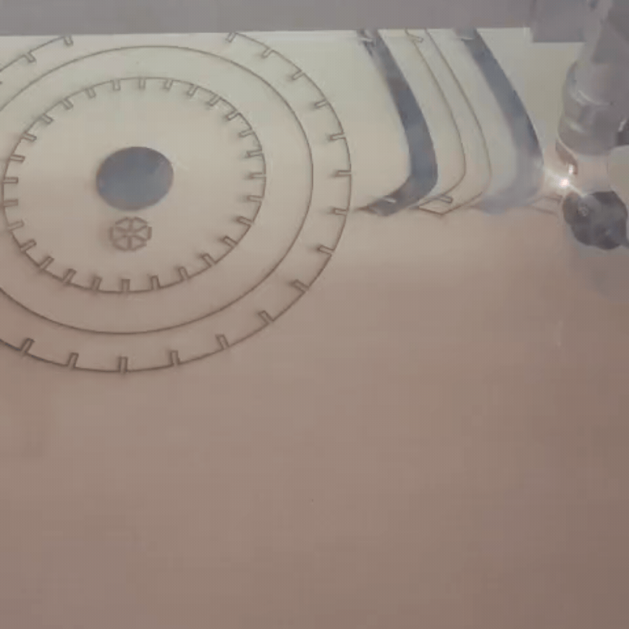{: width="375px"}

**Proceso de armado**

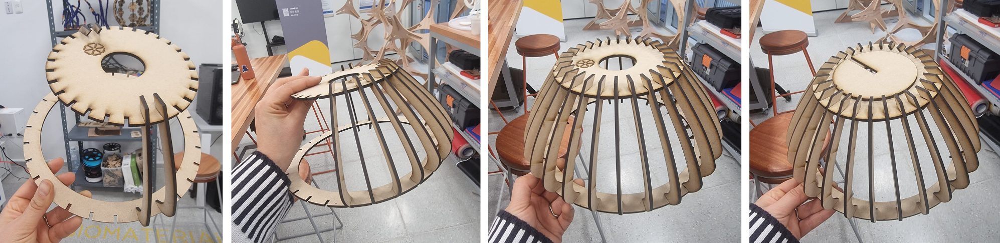{: width="800px"}

