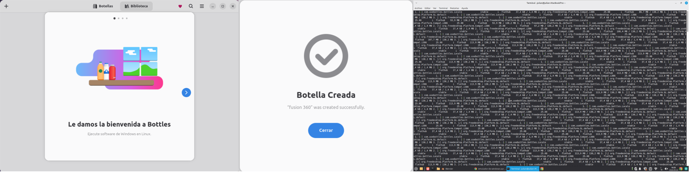
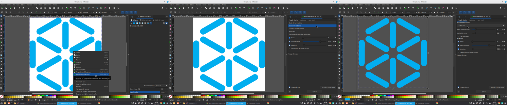
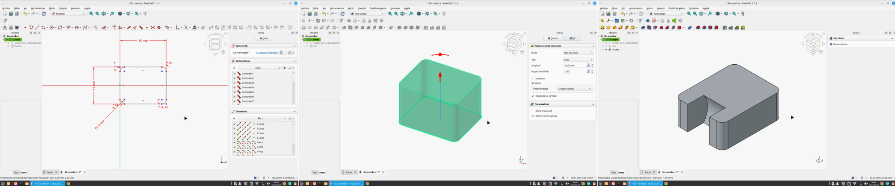
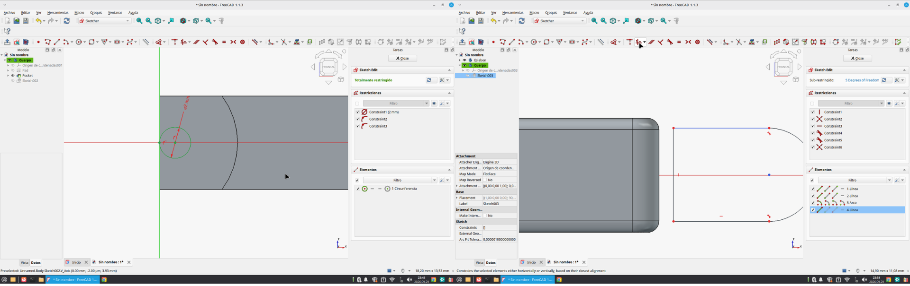
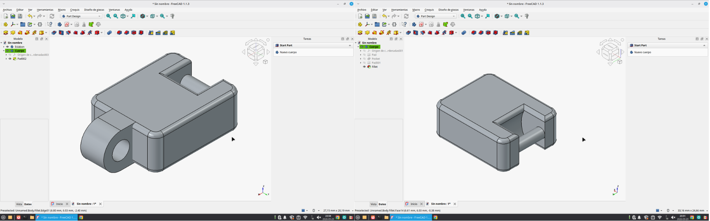
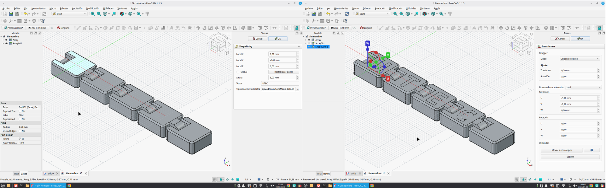
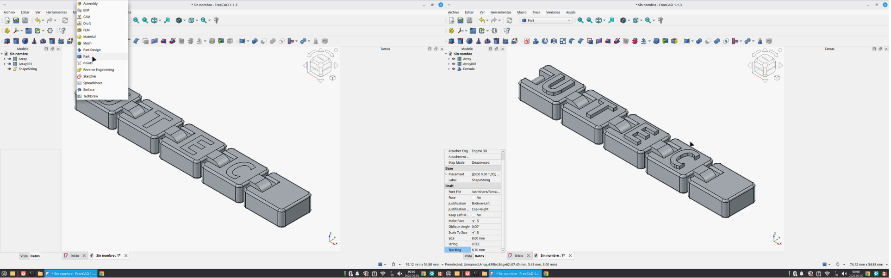
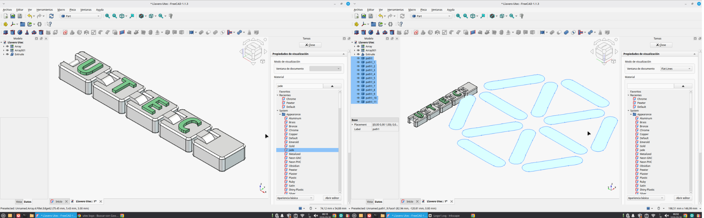
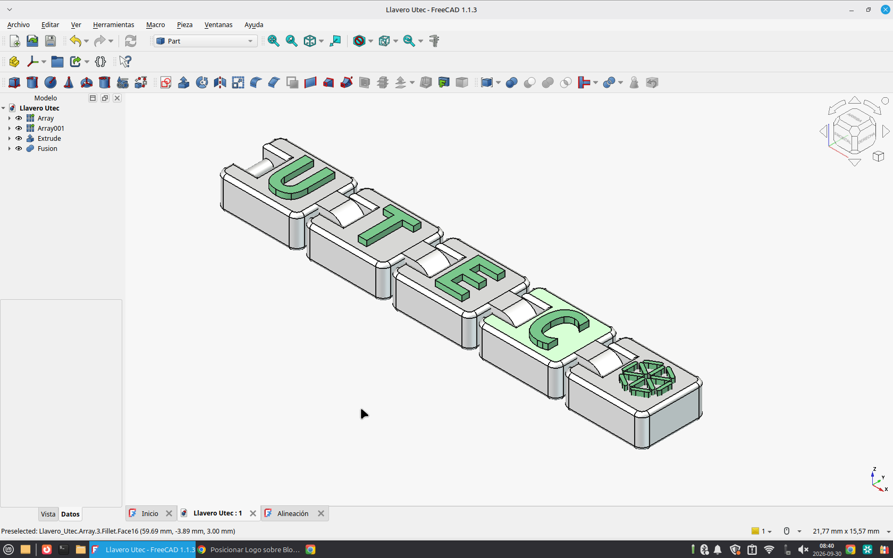

# MT02 - Diseño 2D y Modelado 3D ✒️

Actualmente, mi computadora de trabajo es una MacBook Pro del año 2010. Antes de comenzar el posgrado, se me rompió la computadora que utilizaba y tuve que restaurar esta para poder continuar con mis estudios y proyectos. Para aprovechar mejor sus recursos y mejorar su rendimiento, decidí instalar Linux Mint.

Esta decisión también forma parte de un cambio en mi forma de trabajar: quiero comenzar a utilizar programas de código abierto y herramientas libres que me permitan diseñar, modelar y desarrollar proyectos sin depender de licencias pagas. Me interesa explorar alternativas accesibles que pueda seguir utilizando a largo plazo, durante el posgrado, priorizando herramientas que respeten la libertad de uso. Sin embargo, me vi embarcada a conocer nuevos programas, ya con conocimientos en varios programas en el trayacto de mi trabajo pensé que no iba a ser tan dificil y podria beneficiarme para el dia de mañana sentarme delante de cualquier programa y saber utilizarlo.

Antes el programa de vectores que usaba era Ilustrator, que lo cambiaria por Inskape y en 3d el que mas usé fue fusion 360. En el posgrado nos dieron una licencia por lo tanto, busque la forma de descargarmelo aunque no iba con esta nueva modalidad, porque tengo gran facilidad al usarlo y se todos los beneficios que tiene con el uso de la fabricacion digital.

Me descargué un programa llamado Bottles permite ejecutar aplicaciones de Windows.

{: width="800px"}
Pero no tuve suerte ya que despues de varias horas intentando instalarlo y consultando a la IA, llegué a la conclusion que no soportaba mi tarjeta de video el programa. Por lo tanto, me descargué un programa sin licencia, que en este caso es FreeCad.

**Diseño 2d**

En inskape vectoricé el logo que le iba a colocar al modelado 3d:

*Pasos para vectorizar en Inkscape:*

* Importar imágen: Archivo > Importar.
* Menú superior y seleccionar Trayecto > Vectorizar mapa de bits o también se puede hacer clic derecho sobre la imagen y elegir esa opción (como hice yo).
* Seleccionar la opcion de auto trazo.

{: width="800px"}

**Diseño 3d**

Queria realizar un objeto de escala manual, que tenga que ver con la UTEC. Me decidí realizar un souvenir de la UTEC: un llavero. La parte metálica se agregaria luego. Queria realizar algo simple pero que no sea una pieza sola y que sea articulable para aprender a usar el programa, busqué ideas y concrete la siguiente:

{: width="800px"}
*♡ dibujar y extruir ♡*

{: width="800px"}
*♡ parametrizar y restringír is my obsession ♡*

{: width="800px"}
*♡ Dos primeras piezas realizadas y fillets realizados ♡*

{: width="800px"}
*♡ Replico piezas en espacio de trabajo Draft y agrego letras ♡*

{: width="800px"}
*♡ Vuelvo a Part a extruir letras ♡*

{: width="800px"}
*♡ Le coloco apariencia a las letras e importo el logo: lo escalo y extruyo ♡*

{: width="800px"}
*♡ Listo, llavero terminado ♡*

📥 [Para ver lámina final haceme clic](Láminadepresentación_PaulaDiazCalo.pdf)

*Pd: No pude realizar el render directamente en FreeCAD, ya que aún necesitaba instalar y configurar las herramientas adicionales necesarias para utilizar esa función. Por este motivo, la imagen que se presenta en la lámina fue elaborada con ayuda de inteligencia artificial (ChatGPT), con el objetivo de mejorar la presentación visual del diseño y lograr una apariencia más cercana a una imagen de producto final, en lugar de utilizar únicamente capturas de pantalla del programa.*
