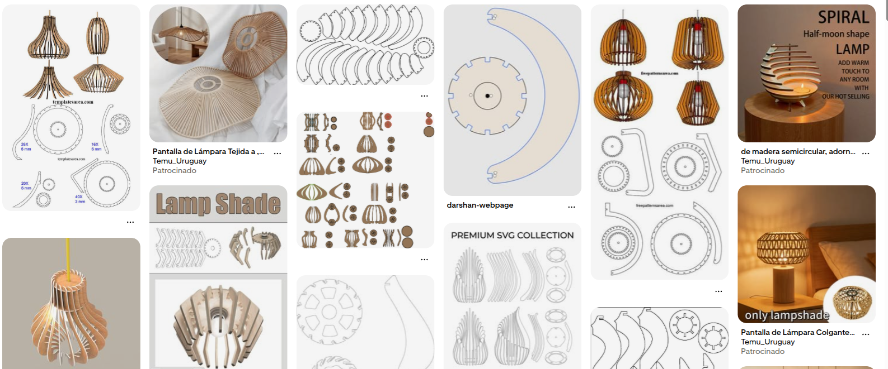
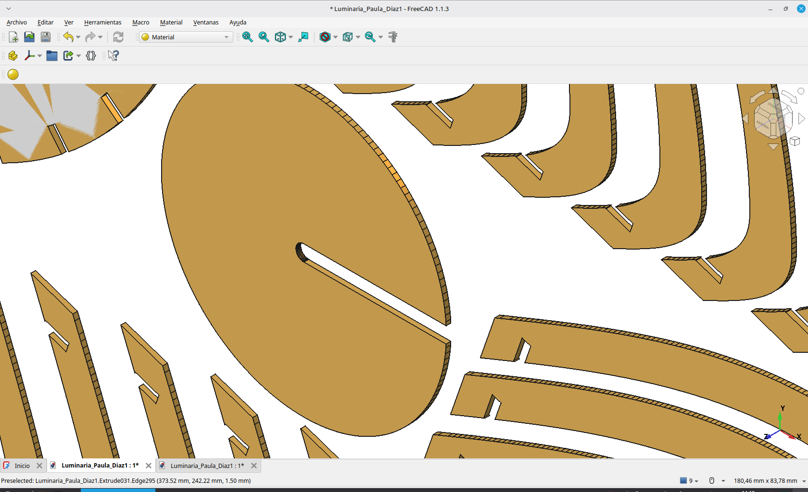
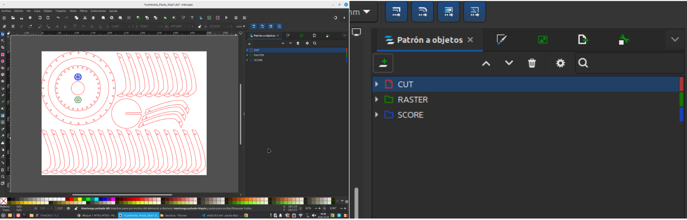
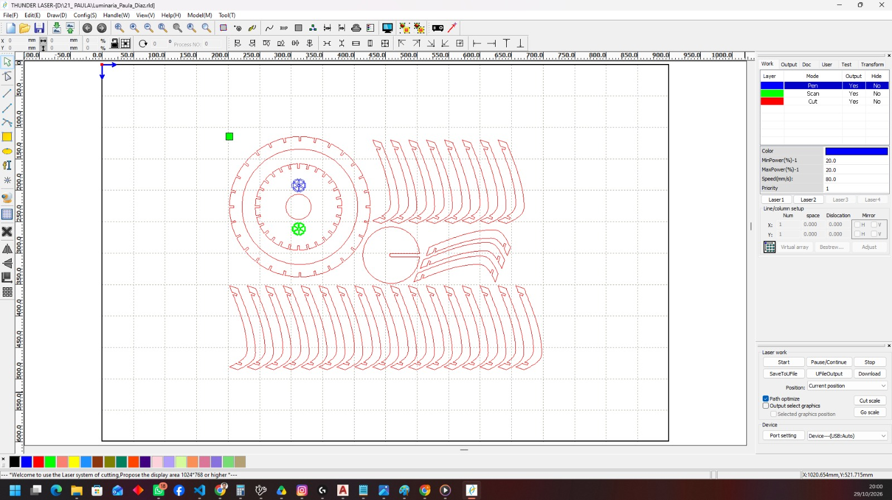
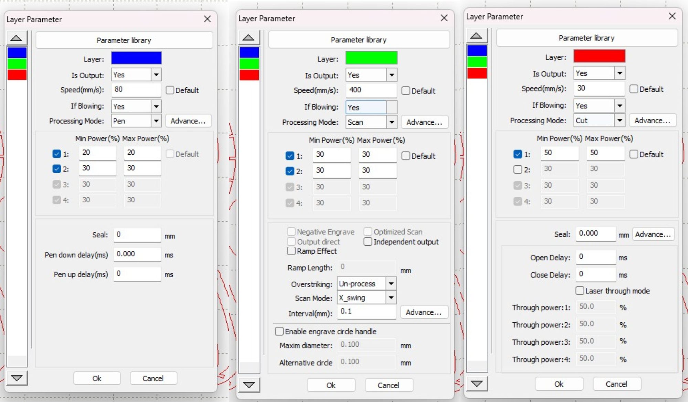

# MT03 - Corte láser controlado por computadora 📐

Para este ejercicio, la consigna consistía en diseñar una luminaria. Decidí desarrollar una propuesta encastrable que pudiera utilizar en mi oficina, ya que necesitaba una, por lo que el diseño se pensó específicamente para ese espacio. Mi intención era crear una pieza de geometría laminar y de fácil ensamblaje. En relación al diseño, hay muchisimas en internet con diferentes encastres, tome de referncias diseños de internet y encastres ya existentes:

{: width="800px"}

En cuanto a la iluminación, busqué que la luz se distribuyera de manera homogénea y que, al mismo tiempo, se filtrara a través de las láminas, proyectando un patrón de luces y sombras sobre el techo. Por otra parte, decidí dejar la parte inferior abierta, sin elementos que obstruyeran la salida de la luz, para favorecer una iluminación directa y funcional sobre la oficina.

Primero modelé en 3d la luminaria [ver captura de imagen de modelado](ImágenesLuminaria.pdf) y luego todas sus partes las coloque en un plano, listo para agregarle en inskape las capas y los logos, para posterior configurarlo en RDWorks.

{: width="800px"}

📥 [Descargar archivo de FreeCAD](Luminaria_Paula_Diaz.FCStd)

**Inskape**

Finalmente, en la pieza de la parte superior incorporé dos versiones del logotipo de UTEC: una lineal y otra raster, con el objetivo de explorar y comparar ambas técnicas de grabado láser.

{: width="800px"}

Agregue tres capas diferentes, en rojo CUT, en verde RASTER y en azul SCORE. Y de la misma forma quiero configurarlo en el archivo RDWorks.

**RDWorks**

Este programa lo tuve que descargar en otra pc ya que es solo para linux.
La configuración la copié de un video tutorial subido a moodle.

{: width="800px"}

*A CUT le coloqué:*

- speed: 30
- procesing mode: cut
- min power: 50 / max power: 50

*A RASTER le coloqué:*

- speed: 400
- procesing mode: scan
- min power: 30 / max power: 30
- Intervalo: 0,02

*A SCORE le coloqué:*

- speed: 80
- procesing mode: pen
- min power: 20 / max power: 20

{: width="800px"}
